 

[English](README.md) · **Español**

## Sobre mí

Soy **Desarrollador Full Stack** y estudiante de Ingeniería en Desarrollo de Software en la Universidad Tecnológica de Durango. Me gustan los sistemas donde la corrección importa: pipelines de datos que se pueden volver a ejecutar sin duplicar nada, APIs con bitácora de auditoría, dinero guardado en enteros y estadística que dice "no hay nada que reportar" en vez de inventar una conclusión.

Trabajo del sensor al dashboard: servicios backend y ETL en **Python** y **TypeScript**, frontends web y móviles, y dispositivos IoT que se comunican con ellos. Cada proyecto principal de abajo tiene pruebas automatizadas y CI, y la mayoría métricas y monitoreo de errores, porque trato un proyecto de portafolio como si alguien tuviera que operarlo.

También construyo productos propios: **Plasticity**, software de gestión para pymes mexicanas que está en desarrollo, y **Legatum Internacional**, una plataforma digital para una firma de asesoría migratoria.

## Qué construyo

<table>
<tr>
<td width="50%" valign="top">

**Pipelines de datos y ETL** 
Cargadores idempotentes que consolidan fuentes desordenadas en un solo modelo relacional, con validación, índices y rastro de lo que cambió.

</td>
<td width="50%" valign="top">

**APIs y plataformas backend** 
Servicios con FastAPI, Express, Fastify y Spring Boot con autenticación JWT, acceso por roles, secretos cifrados, límites de tasa y manejo de dinero seguro ante concurrencia.

</td>
</tr>
<tr>
<td valign="top">

**Web y móvil** 
Apps con Angular, React y Next.js, sitios Astro en Cloudflare, apps React Native y Flutter, incluida una publicada en Google Play y App Store.

</td>
<td valign="top">

**IoT e IA aplicada** 
Dispositivos ESP32 y Raspberry Pi por MQTT y WebSocket, y asistentes de IA construidos en hackathones (AWS serverless, OCR, triage por voz).

</td>
</tr>
</table>

## Stack tecnológico

## Plasticity

*Privado, en desarrollo activo desde octubre de 2026.*

Software de gestión para pequeñas y medianas empresas mexicanas que **toma la forma de cada negocio**. Lo diseño y construyo de punta a punta: producto, backend, frontend, seguridad e infraestructura. Los detalles se mantienen privados por ahora y con gusto lo platico en una entrevista.

## Proyectos destacados

| Proyecto | Qué demuestra | Stack |
|---|---|---|
| [**tramex-etl**](https://github.com/alexander-tinoco/tramex-etl) | Reemplazó la hoja de cálculo compartida que una agencia migratoria usaba como base de datos. ETL idempotente, credenciales cifradas en reposo y bitácora de auditoría de quién consultó qué, cuándo y desde qué IP. 245 pruebas, 90.4% de cobertura. | FastAPI · Angular · PostgreSQL · Prometheus · Grafana · Sentry |
| [**payroll**](https://github.com/alexander-tinoco/payroll) | Sistema de auditoría y consulta de nómina pública. El ETL en Python carga unos 292 mil registros en unos 35 segundos, con caché en Redis, documentación OpenAPI y gobernanza con ADRs. | Express · React · Python · PostgreSQL · Redis |
| [**theclub-api**](https://github.com/alexander-tinoco/theclub-api) | Motor de ruleta con juego justo verificable: compromiso y revelación HMAC-SHA256, dinero en enteros respaldado por un libro contable, patrón outbox para Kafka y rotación de refresh tokens JWT. 220 pruebas, 99% de cobertura. | FastAPI · Kafka · PostgreSQL · Redis · Loki |
| [**survey-analitics**](https://github.com/alexander-tinoco/survey-analitics) | Análisis de encuestas más allá de los porcentajes: chi-cuadrada y V de Cramér con corrección FDR, perfiles k-means validados con una prueba de permutación y hallazgos en lenguaje claro. 383 pruebas, 98.6% de cobertura. | Django · DRF · Celery · Redis · PostgreSQL |
| [**job**](https://github.com/alexander-tinoco/job) | Selección de currículums explicable: cada calificación lleva la frase de la que salió y el ranking lo calcula Python, para que un currículum no pueda escalar con redacción. 415 pruebas. | FastAPI · React · PostgreSQL |
| [**legatum-web**](https://github.com/alexander-tinoco/legatum-web) | Sitio y sistema de crecimiento de una firma de asesoría migratoria que fundé, en [legatum-internacional.com](https://www.legatum-internacional.com/): 5 servicios, 11 artículos, 4 herramientas interactivas, 2 landing pages de anuncios, arquitectura SEO y de datos estructurados, embudo de leads, auditoría estratégica documentada (anuncios, palabras clave, CRO, WhatsApp) y toda la configuración de Cloudflare. | Astro · Cloudflare Workers · Turnstile · Brevo |
| **Puertia** *(privado, proyecto de práctica)* | Plataforma de invitaciones digitales: cada invitación aislada en sus propios assets, componentes y datos, con RSVP, registro por QR, fotos en R2, correo con Resend, pruebas de carga con k6 (100 confirmaciones simultáneas), auditorías SEO y legal, runbook y endpoints de derechos ARCO. | Astro 7 · Fastify · PostgreSQL · Drizzle · Cloudflare |
| [**nexobank-backend**](https://github.com/alexander-tinoco/nexobank-backend) y [**nexobank-mobile**](https://github.com/alexander-tinoco/nexobank-mobile) | Un banco digital como par de portafolio: libro contable de solo escritura y transferencias seguras ante concurrencia, detrás de una app Flutter con saldos en tiempo real. | FastAPI · Celery · Flutter · WebSocket |
| [**taxi-gymnasium**](https://github.com/alexander-tinoco/taxi-gymnasium) | Agente de Q-learning tabular que resuelve Taxi-v4 de Gymnasium y reproduce su política en pygame. | Python · Gymnasium · pygame |

## Código en GitHub

*Solo repositorios públicos. Plasticity y Puertia son privados y no se cuentan.*

## Trayectoria

### Experiencia

- **Fundador y desarrollador, Plasticity** (oct 2026 a la fecha). Software de gestión para pymes mexicanas, en desarrollo.
- **Desarrollador Full Stack, GMC Store** (jul 2025 a ene 2026). Sistema de registro de accesos: Spring Boot y Angular con Scrum, JWT con roles de administrador y empleado, enlace WebSocket en tiempo real con una Raspberry Pi que abre torniquetes físicos con lectura de QR, código de barras y RFID, reportes PDF con JasperReports y una app React Native y Expo publicada en Google Play y App Store.
- **Desarrollador Full Stack, Jardinería Ornamental** (feb a jul 2025). Diseñé la arquitectura y construí una API con Express y TypeScript con JWT y acceso por rol, además de un microcontrolador ESP32 con sensores que controla una cortadora de pasto por MQTT, una app de control en React Native y el sitio de la empresa.
- **Desarrollador Full Stack, Blue Bird LLC** (dic 2024 a ene 2025). Diseñé y desarrollé el sitio de la empresa con Astro, TypeScript y Tailwind, y me encargué del hosting.

### Hackathones

| Evento | Qué hice | Resultado |
|---|---|---|
| **Capital One Genius Arena** · TalentLand 2025 | Desarrollador de software e ingeniero de IA en *Amir, FinancIA*, un asistente de salud financiera. Arquitectura serverless en AWS (Lambda, API Gateway, Cognito, DynamoDB, SageMaker, CloudWatch). | Semifinalista |
| **HackMTY 2025** · Banorte Smart Cities | Frontend en React Native y Expo de *Banagochi*, con verificación de identidad y un agente conversacional con IA, en 48 horas con un equipo de tres. | Participante |
| **HackMTY 2024** · Banorte AI App | Backend en Node.js con OCR para validar datos sensibles de una app de recomendación financiera. | Participante |
| **HACKDGO Summit 2024** | Backend en Node.js y flujos conversacionales de un asistente de voz con IA que hace el triage de pacientes antes de la consulta, integrado con HUME AI. | Finalista |

### Educación y certificaciones

- **Ingeniería en Desarrollo de Software**, Universidad Tecnológica de Durango (2025 a 2027, en curso)
- **Técnico Superior Universitario en Tecnologías de la Información**, Universidad Tecnológica de Durango (2023 a 2025)
- **Oracle Next Education**, programa de habilidades técnicas y blandas (2024 a 2025)
- AWS Academy Cloud Foundations · Cisco Linux Essentials · From Relational Model to Mongo · Networking Academy Learn-A-Thon 2024

## Ahora mismo

Estoy construyendo Plasticity y avanzando un plan de estudio 2026 de nueve libros, cuatro certificaciones (entre ellas Databricks, Docker y Kubernetes, y GCP) y doce proyectos aplicados. El tracker que hice para eso es público: [personal_strategy](https://github.com/alexander-tinoco/personal_strategy).

## Hablemos

Estoy abierto a conversar sobre puestos de backend, ingeniería de datos y full stack. La forma más rápida de contactarme es [LinkedIn](https://www.linkedin.com/in/alexander-tinoco-sanchez-1a45a4273).

Los gráficos de este perfil los genera [`scripts/build_assets.py`](scripts/build_assets.py) con datos reales de mis proyectos. Iconos de marca de [simple-icons](https://simpleicons.org) (CC0).
