 

## About me

I am a **Full Stack Developer** and Software Engineering student at the Universidad Tecnológica de Durango. I like systems where correctness matters: data pipelines that can be re-run without duplicating anything, APIs that keep an audit trail, money stored as integers, and statistics that say "nothing to report" instead of inventing a conclusion.

I work from the sensor to the dashboard: backend services and ETL in **Python** and **TypeScript**, web and mobile front ends, and IoT devices that talk to them. Every flagship project below ships with automated tests and CI, and most with metrics and error monitoring, because I treat a portfolio project as if someone had to operate it.

## What I build

<table>
<tr>
<td width="50%" valign="top">

**Data pipelines and ETL** 
Idempotent loaders that consolidate messy sources into one relational model, with validation, indexing and a trail of what changed.

</td>
<td width="50%" valign="top">

**Backend APIs** 
FastAPI, Express, Fastify and Spring Boot services with JWT auth, role-based access, encrypted secrets, rate limiting and concurrency-safe money handling.

</td>
</tr>
<tr>
<td valign="top">

**Web and mobile** 
Angular and React dashboards, Astro sites on Cloudflare, React Native and Flutter apps, including one published on Google Play and the App Store.

</td>
<td valign="top">

**IoT and applied AI** 
ESP32 and Raspberry Pi devices over MQTT and WebSocket, plus AI assistants built at hackathons (AWS serverless, OCR, voice triage).

</td>
</tr>
</table>

## Tech stack

## Featured projects

| Project | What it demonstrates | Stack |
|---|---|---|
| [**tramex-etl**](https://github.com/alexander-tinoco/tramex-etl) | Replaced the shared spreadsheet an immigration agency used as its database. Idempotent ETL, credentials encrypted at rest and a full audit log of who read what, when and from which IP. 245 tests, 90.4% coverage. | FastAPI · Angular · PostgreSQL · Prometheus · Grafana · Sentry |
| [**payroll**](https://github.com/alexander-tinoco/payroll) | Audit and query system over public payroll data. Python ETL loads about 292k records in roughly 35 seconds, with Redis caching, OpenAPI docs and ADR-based governance. | Express · React · Python · PostgreSQL · Redis |
| [**theclub-api**](https://github.com/alexander-tinoco/theclub-api) | Provably fair roulette engine: HMAC-SHA256 commit-reveal, a ledger-backed integer money model, the outbox pattern for Kafka and JWT refresh rotation. 220 tests, 99% coverage. | FastAPI · Kafka · PostgreSQL · Redis · Loki |
| [**survey-analitics**](https://github.com/alexander-tinoco/survey-analitics) | Survey analysis that goes beyond percentages: chi-square and Cramér's V with FDR correction, k-means profiles checked against a permutation test, and plain-language findings. 383 tests, 98.6% coverage. | Django · DRF · Celery · Redis · PostgreSQL |
| [**job**](https://github.com/alexander-tinoco/job) | Explainable résumé screening: every score carries the sentence it came from, and the ranking is computed in Python so a résumé cannot talk its way up. 415 tests. | FastAPI · React · PostgreSQL |
| [**legatum-web**](https://github.com/alexander-tinoco/legatum-web) | Marketing site for an immigration advisory firm, at [legatum-internacional.com](https://www.legatum-internacional.com/): SEO and schema architecture, a lead-gen funnel and full Cloudflare setup. | Astro · Cloudflare Workers · Turnstile · Brevo |
| [**nexobank-backend**](https://github.com/alexander-tinoco/nexobank-backend) and [**nexobank-mobile**](https://github.com/alexander-tinoco/nexobank-mobile) | A digital bank as a portfolio pair: append-only ledger and concurrency-safe transfers behind a Flutter app with live balance updates. | FastAPI · Celery · Flutter · WebSocket |
| [**taxi-gymnasium**](https://github.com/alexander-tinoco/taxi-gymnasium) | Tabular Q-learning agent that solves Gymnasium's Taxi-v4 and replays its policy in pygame. | Python · Gymnasium · pygame |

## Code on GitHub

## Journey

### Experience

- **Full Stack Developer, GMC Store** (Jul 2025 to Jan 2026). Access-control system: Spring Boot and Angular under Scrum, JWT with admin and employee roles, real-time WebSocket link to a Raspberry Pi that opens physical turnstiles from QR, barcode and RFID reads, PDF reports with JasperReports, and a React Native and Expo app published on Google Play and the App Store.
- **Full Stack Developer, Jardinería Ornamental** (Feb to Jul 2025). Designed the architecture and built an Express and TypeScript API with JWT and role-based access, plus an ESP32 microcontroller with sensors that remotely controls a lawn mower over MQTT, a React Native control app and the company website.
- **Full Stack Developer, Blue Bird LLC** (Dec 2024 to Jan 2025). Designed and built the company site with Astro, TypeScript and Tailwind, and handled hosting.

### Hackathons

| Event | What I did | Result |
|---|---|---|
| **Capital One Genius Arena** · TalentLand 2025 | Software and AI engineer on *Amir, FinancIA*, a financial-health assistant. Serverless AWS architecture (Lambda, API Gateway, Cognito, DynamoDB, SageMaker, CloudWatch). | Semifinalist |
| **HackMTY 2025** · Banorte Smart Cities | React Native and Expo front end for *Banagochi*, with identity verification and an AI chat agent, in 48 hours with a team of three. | Participant |
| **HackMTY 2024** · Banorte AI App | Node.js backend with OCR validation of sensitive data for a financial recommendation app. | Participant |
| **HACKDGO Summit 2024** | Node.js backend and conversation flows for an AI voice assistant that triages patients before a consultation, integrated with HUME AI. | Finalist |

### Education and certifications

- **B.Eng. in Software Development**, Universidad Tecnológica de Durango (2025 to 2027, in progress)
- **Higher University Technician in Information Technology**, Universidad Tecnológica de Durango (2023 to 2025)
- **Oracle Next Education**, technical and soft skills program (2024 to 2025)
- AWS Academy Cloud Foundations · Cisco Linux Essentials · From Relational Model to Mongo · Networking Academy Learn-A-Thon 2024

## Right now

I am working through a 2026 study roadmap of nine books, four certifications (including Databricks, Docker and Kubernetes, and GCP) and twelve applied projects. The tracker I built for it is public: [personal_strategy](https://github.com/alexander-tinoco/personal_strategy).

## Let's connect

I am open to conversations about backend, data engineering and full stack roles. The fastest way to reach me is [LinkedIn](https://www.linkedin.com/in/alexander-tinoco-sanchez-1a45a4273).

The graphics in this profile are generated by [`scripts/build_assets.py`](scripts/build_assets.py) from real project data. Brand icons from [simple-icons](https://simpleicons.org) (CC0).
